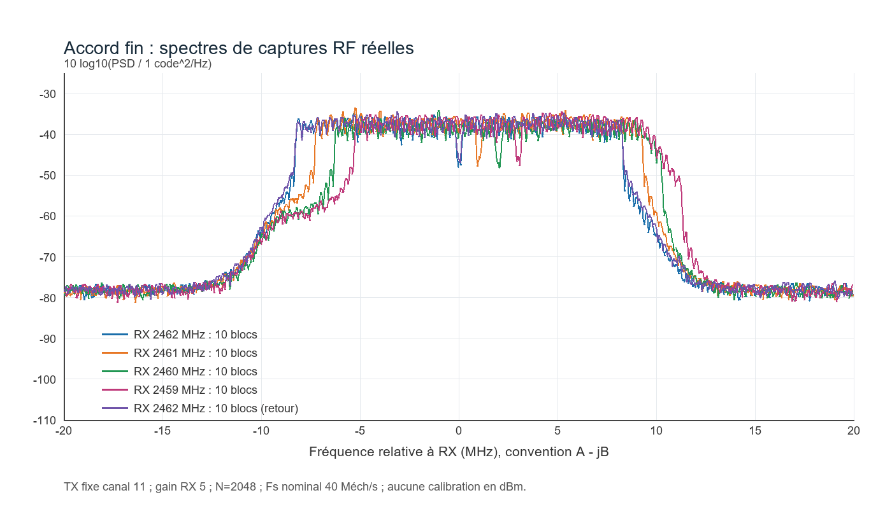
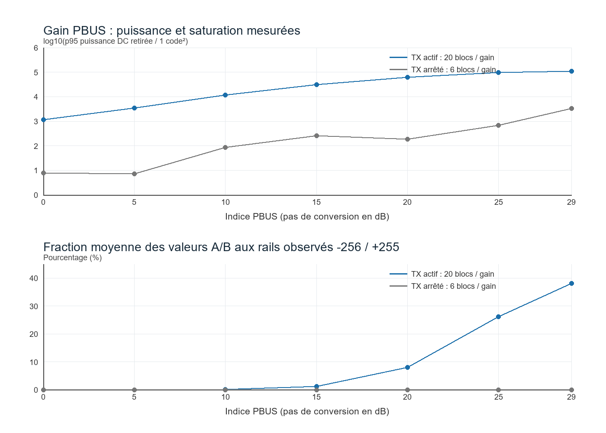
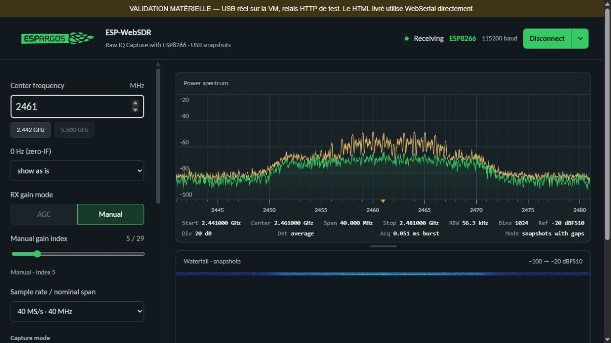

# Qualification du port ESP8266 WebSDR

Essais du 20 octobre 2026. Ce rapport distingue les vérifications du protocole,
les mesures radio et les essais du navigateur.

## Version courante : v4 à 1 Mbaud

À la demande de l'utilisateur, le sketch démarre désormais à **1 000 000 bauds**.
Le HTML préfère ce même débit dès la première ouverture et pour la session ;
modifier seulement le sketch aurait laissé la page demander son ancien défaut
à 115200. Le contrôle CRC, la resynchronisation et le retour explicite vers
115200 sont conservés. L'espacement `PACE 3000` reste inchangé.

Les sections suivantes conservent les résultats historiques v2/v3, à leurs
débits et dans leurs conditions d'origine. Elles ne constituent pas une nouvelle
qualification RF de v4. Les nouveaux contrôles se limitent à la compilation,
aux tests logiciels de connexion et à la liaison série de commande.

Résultats v4 :

- compilation réussie avec le même cœur Arduino 3.1.2 et les mêmes réglages ;
- téléversement sur le récepteur `68:c6:3a:d6:0e:e8`, puis égalité MD5 de la flash ;
- démarrage `READY ESP8266SDR code=1` lu à **1 000 000 bauds** ;
- après attente du démarrage, **35 réponses série exactes**, sans reprise :
  synchronisation, `INFO`, `TRANSPORT?` et 32 échos avec jetons distincts ;
- réponse `TRANSPORT UART 1000000` confirmée ;
- tests frontend réussis : nouveau démarrage à 1 Mbaud sans changement de débit,
  compatibilité des anciens démarrages, retour à 115200 et contrôles CRC ;
- aucune commande de capture, d'accord, de gain ou d'émission envoyée pendant
  cette vérification. La capture automatique préexistante de `setup()` est conservée.

Un premier contrôle série avait commencé avant la fin du démarrage et reçu
`READY` à la place de la réponse attendue. Ce journal est conservé ; le contrôle
final attend le démarrage puis se synchronise. Ce contrôle court des commandes
ne démontre pas l'absence de perte sur de longs transferts.

| Fichier v4 | SHA-256 |
| --- | --- |
| `ESP8266_WebSDR.html` (logo ESPBoOm8266) | `14e06c93bd9cbfe1714d9a2fa6903617b2814ea7fbb5468ac6c776d330105faf` |
| `ESP8266_WebSDR/ESP8266_WebSDR.ino` | `527d7eb6b6d740bd2e3f14dd4e5d2f39970c59d04ce8d4f6194581703577362f` |
| `validation/firmware_v4_1M.bin` | `c218c48382eb7faf5d4ee4fdb932f474bf143f5ce09b4f8aabfe88d306c1bb28` |

Preuves : [v4_1M_evidence.tgz](validation/v4_1M_evidence.tgz).
Le récepteur est laissé sous v4 à 1 Mbaud, port série libéré.
La seconde carte n'a pas été reprogrammée.

Personnalisation visuelle ultérieure : le logo d'en-tête a été remplacé par
le lettrage SVG **ESPBoOm8266**, intégré dans le HTML. Le lien du logo vers
ESPARGOS a été retiré ; les crédits et licences d'origine sont conservés.
Ce changement ne modifie ni le sketch ni les scripts de transport série.
Les captures d'écran des essais RF historiques montrent encore l'ancien logo.
Le rendu du nouveau logo a été vérifié dans le navigateur, sans connexion
matérielle ni erreur JavaScript :
[aperçu ESPBoOm8266](validation/interface_ESPBoOm8266.png).

Avant ce changement, un benchmark série seul sur USB natif a observé des pertes
à 1 Mbaud avec le stub Espressif en RAM : deux blocs de 256 Kio avaient passé le
contrôle court, puis un transfert prolongé a échoué après un premier bloc valide.
Le bloc SLIP attendu de 4096 octets n'en contenait que 3583. Les données n'ont
pas été réparées ou retransmises pour transformer cet échec en réussite.
Ce test concerne le transport du stub, distinct du protocole I/Q et de ses pauses.
La campagne a été interrompue avant l'essai de la seconde carte ; aucune
comparaison complète des deux cartes n'est revendiquée.

## Matériel et compilation

- Récepteur : ESP8266, MAC `68:c6:3a:d6:0e:e8`, pont CH341.
- Émetteur de test séparé : ESP8266, MAC physique `b4:e6:2d:23:0e:f4`.
- Arduino ESP8266 **3.1.2**, SDK `NONOSDK22x_190703`, CPU **80 MHz**.
- FQBN : `esp8266:esp8266:nodemcuv2:xtal=80,eesz=4M1M`.
- Aucune archive RFTest, aucun firmware RFTest, aucun linker personnalisé.
- Le firmware v3 de la livraison précédente a été écrit sur le récepteur identifié par sa MAC, puis
  comparé à sa flash par MD5. Le démarrage a produit `READY ESP8266SDR code=1`.

Placement vérifié dans l'ELF :

| Objet | Adresse | Taille |
| --- | --- | --- |
| `iqStorage`, capture et gardes | `0x3FFE8000` | `0x2040` |
| Copie privée `saved` | `0x3FFF0B2C` | `0x2000` |
| Début du tas | `0x3FFF3468` | — |

L'assemblage de `iqCapture` ne contient aucun appel entre le masquage des IRQ
à `0x40100289` et leur restauration à `0x40100388`. La compilation utilise
46 128 octets de données et constantes RAM sur 80 192, et 28 083 octets d'IRAM
de code sur les 32 768 disponibles hors cache.

## Protocole et transport

À **115200 bauds**, la suite matérielle initiale a validé :

- l'identité, les capacités, les limites et la synchronisation ;
- le rejet de 13 commandes invalides et d'une ligne de 1024 caractères ;
- les comptes de 2, 3, 7, 128, 129, 2047 et 2048 couples ;
- **37 captures** au total, avec CRC correct ;
- la correspondance entre les captures compactées et les mots bruts `RAW?` ;
- les sommes A, B et A²+B² calculées indépendamment et comparées à `STAT?` ;
- des gardes intactes et aucune écriture au-delà de la capture ;
- le changement de débit puis le retour synchronisé.

Pour 2048 couples, le compteur matériel a indiqué 4124 cycles à 80 MHz,
soit 51,55 µs entre déclenchement et détection de fin. Le protocole arrondit cette
durée à 52 µs. La durée nominale des **échantillons** est 51,2 µs ; elle n'inclut
pas l'encodage ni le transfert. Un transfert CAP20 de cette taille occupe environ
470 ms sur la liaison testée à 115200 bauds.

**Limite constatée :** le chemin USB redirigé vers cette VM perd des octets à
1 et 2 Mbaud. Des pauses de 3000 ou 5000 µs entre blocs de 64 octets n'ont pas
suffi à garantir tous les transferts. Un essai USBFS avec 64 requêtes en attente
a également perdu un octet dans de longs blocs. Le marqueur SYNC suivant était
intact ; l'octet absent n'attendait pas le transfert suivant. La cause exacte
n'est pas localisée. Ces résultats ne prouvent pas le comportement d'un port
USB Windows branché directement.

La version historique v3 démarrait **directement à 115200 bauds**, comme sa page.
La validation navigateur a montré que la fermeture/réouverture du port pour
changer le débit pouvait réinitialiser la carte. La version v2 revenait alors
à 2 Mbaud et le navigateur refusait correctement le débit incohérent. Le
démarrage à 115200 évite cette transition dans l'utilisation normale.
Les commandes BAUD à 1 et 2 Mbaud restent disponibles pour des diagnostics,
sans garantie sur cette installation.

Des essais RF prolongés à 115200 ont également rencontré des réponses
tronquées : ce débit n'est pas une garantie de zéro perte. Le logiciel reprend
après resynchronisation, avec un nombre d'essais borné.

Les captures tronquées ou dont le CRC ne correspond pas sont rejetées avant
calcul du spectre.

Le contrôle final sur **v3** a parcouru les **51 fréquences entières** de
2412 à 2462 MHz et les **30 indices de gain**, avec une capture de 32 couples
et sa lecture RAW à chaque point. Les 81 points ont passé CRC, sommes,
profil et gardes, sans reprise nécessaire. Une capture finale de 2048 couples
avec RAW a également passé ces contrôles. Cela valide les commandes et le
moteur aux réglages parcourus ; la preuve RF détaillée concerne les points
du tableau suivant.

## Mesures radio

Les acquisitions quantitatives ont été faites sur v2. Entre v2 et v3, seules
la constante du débit de démarrage et des commentaires ont changé. Le
désassemblage de `iqCapture` est identique, avec SHA-256
`8b9decf578dccc7159da7bf615f758f8e80aee04787daf7b7f60ed456d3d1218`.
Le navigateur a ensuite reçu les signaux réels du second ESP8266 avec v3.

Avec l'émetteur fixé au canal 11 et le gain du récepteur à 5, les mesures sur
50 blocs forts de 2048 couples montrent :

| Centre RX demandé | Déplacement RF mesuré par rapport au premier 2462 |
| --- | --- |
| 2462 MHz | référence |
| 2461 MHz | +1,035156 MHz |
| 2460 MHz | +1,992188 MHz |
| 2459 MHz | +2,988281 MHz |
| 2462 MHz, retour | 0,000000 MHz |

Ces déplacements viennent du motif spectral des captures, indépendamment de
`STAT?`. La résolution FFT est 19,53125 kHz. Une paire de préambules LTF à
2461 MHz donne indépendamment +1,016063 MHz. Le SIGNAL associé n'a pas passé
le critère strict de décodage ; aucune trame complète décodée n'est revendiquée.

Sept indices de gain ont été mesurés sur 20 blocs actifs de 512 couples par
indice. La puissance augmente avec le gain ; les indices élevés écrêtent
fortement dans cette géométrie : rails moyens 0 % aux indices 0 et 5, 7,9 %
à 20, 38,0 % à 29. Il ne s'agit pas d'un étalonnage en dB.

Les données tronquées ont été rejetées, jamais réparées pour produire ces
figures. Méthode, limites et données : [rapport RF](validation/rf/RESULTATS_RF.txt),
[mesures JSON](validation/rf/resume_rf.json), [archive originale](validation/rf/rf_evidence.tgz).

## Page et intégration

L'interface dérive du dépôt ESPARGOS `esp-web-sdr`, commit
`6995ed78915a034be54be68abf986d608d7624c4`. Les styles, polices intégrées, logo
et structure des contrôles sont conservés. Le profil matériel et les textes
ont été adaptés à l'ESP8266.

Le HTML livré contient ses ressources et utilise WebSerial directement.
Sa politique de sécurité interdit les connexions réseau (`connect-src 'none'`).
Il ne contient pas de générateur de signaux ni de périphérique simulé.

Les tests logiciels couvrent le décodage signé et compacté, le CRC, les lectures
fragmentées, les erreurs et la resynchronisation, les capacités négociées,
l'accord sur la grille autorisée et les états des contrôles.

La page a été connectée aux octets série **réels** du récepteur sur la VM,
avec un relais HTTP de laboratoire limité à `localhost` et à un tunnel SSH.
Seul le transport de test était adapté ; les commandes, le décodeur CRC,
la FFT et le rendu étaient ceux de la page. Aucune donnée n'était simulée
ou rejouée. Ce relais n'est ni intégré ni requis dans le HTML livré.

Vérifications observées : connexion à 115200, captures CRC valides, saisie
native de 2462 puis 2461 MHz, gain 5, FFT 2048 puis 1024, maintien des maxima,
pause/reprise, déconnexion et reconnexion. Le débit observé était environ
1,4 à 1,5 capture/s avec le relais, pour environ 650 à 680 ms par acquisition
et transfert. Ces valeurs incluent le relais de test.

Le sélecteur de périphérique WebSerial sous Chrome/Edge avec le pont USB
branché directement sur Windows n'a pas été exercé : la carte était attachée
à la VM. Son API a été vérifiée par tests logiciels. La procédure directe
consiste à libérer le pont USB de la VM, puis ouvrir le HTML dans Chrome/Edge.

Les instantanés de l'interface et les journaux de contrôle sont conservés
dans `validation/navigateur_*.txt`. Une saisie automatisée par simple `fill`
sans événement `change` n'avait pas envoyé la fréquence ; la frappe native
et la sortie du champ ont confirmé le comportement normal.

## Portée des résultats

Il s'agit d'un récepteur de **captures I/Q espacées**, limité à la bande
2,4 GHz et aux réglages documentés. Le taux de 40 Méch/s est nominal ; aucun
étalonnage de fréquence ou de puissance par instrument de référence n'a été fait.
Les niveaux sont relatifs, en dBFS10, et les gains sont des indices sans unité.
Le fonctionnement sur un autre cœur Arduino, un autre SDK, une autre fréquence
CPU ou une autre disposition mémoire n'est pas établi.

Les preuves initiales de compilation, désassemblage, flash et protocole sont
dans `validation/v2_initial_evidence.tgz`. Les essais infructueux à haut débit
y sont conservés avec les essais réussis à 115200 bauds.

## Vérification de la livraison précédente v3

Le HTML v3 a reçu cinq captures valides sur le récepteur réel à 115200 bauds.
La première ouverture se fait directement à ce débit. Pause/reprise et capture
de page complète n'ont produit aucun avertissement ni erreur JavaScript.
Le test de régression des dimensions nulles des canvas conserve l'historique
de la cascade lors du masquage puis du réaffichage.

Après ce dernier essai, une lecture MD5 de la flash a confirmé le binaire v3 :
`5064cac69203446d5eff6b9e5c4d51cb`, soit 286208 octets.
Ce contrôle n'a pas réécrit la flash. Le redémarrage a émis
`READY ESP8266SDR code=1` à 115200 bauds.

| Fichier de la livraison précédente | SHA-256 |
| --- | --- |
| `ESP8266_WebSDR.html` | `e7e93da0d217a8a8e55b6a7667528af53cf206339ef687064b7cd64ed044031b` |
| `ESP8266_WebSDR/ESP8266_WebSDR.ino` | `7e37951b501ae48915c5fb0de4f5075de862051abad9b17a9d9930664ecbe434` |
| `validation/firmware_v3.bin` | `a46c8aa4b8760203e55dd5738c22e830ab0f05a1ab3f273314643688789be631` |

Les preuves v3 sont réunies dans
[v3_final_evidence.tgz](validation/v3_final_evidence.tgz) :
compilation, désassemblage, flash, balayage des 51 fréquences et 30 gains
sans nouvelle tentative, contrôle final de la flash et journaux du navigateur.
Le journal du relais conserve son chemin historique `v2/browser_bridge.log` ;
ses derniers essais utilisent bien le firmware v3.

À la fin des tests v3, le récepteur conservait le firmware v3. L'émetteur a confirmé
`state=OFF` et `sdk_mode=0`. Les deux ports série ont été libérés et les serveurs
de validation arrêtés. La connexion USB du récepteur reste attachée à la VM :
la libérer avant l'utilisation directe depuis Chrome ou Edge sous Windows.

`SHA256SUMS.txt` recense les fichiers inclus dans l'archive de livraison.
Les traces brutes RF sont conservées sous forme d'archive, sans dupliquer leur
extraction dans le ZIP.
